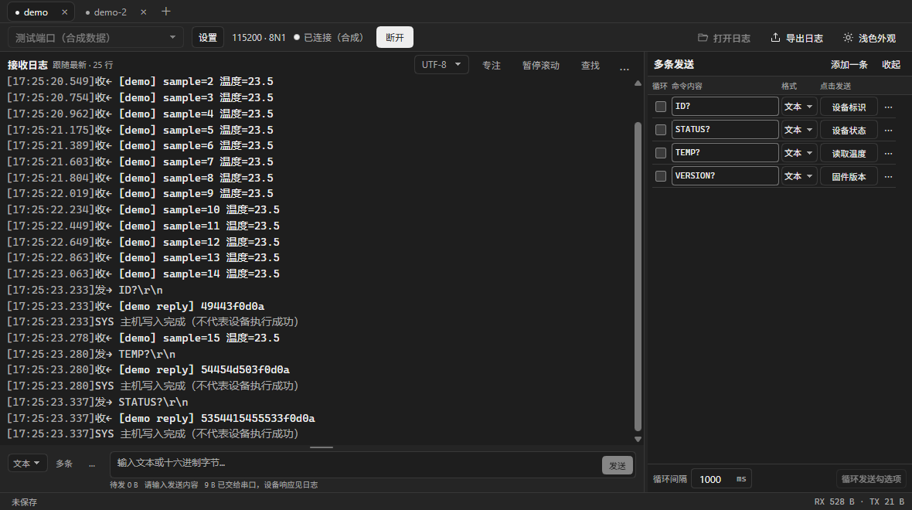
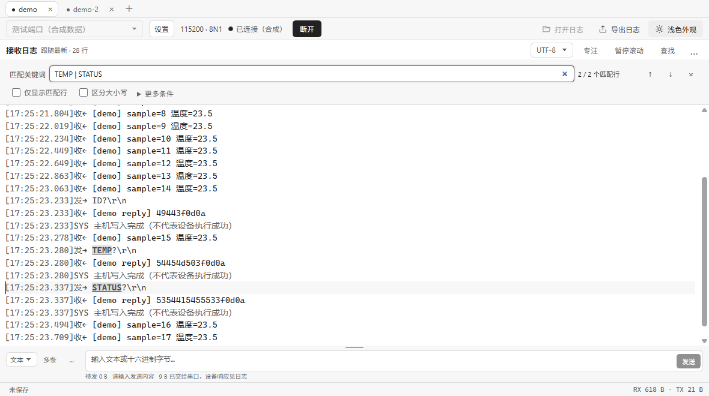

# Baudloom

Baudloom 是一个以接收日志为主的桌面串口调试工具。在同一个窗口里打开多个 COM 口，每个标签页都有自己的日志、发送草稿和会话记录。支持 UTF-8 与 HEX 收发，中文界面，本地运行。

**[下载 Windows x64 目录版（ZIP）](https://github.com/Oniums/baudloom/releases/latest/download/Baudloom-Windows-x64.zip)** · [0.1.8 发布说明与校验文件](https://github.com/Oniums/baudloom/releases/tag/v0.1.8) · [更新记录](CHANGELOG.md) · [报告问题](https://github.com/Oniums/baudloom/issues)



*截图中的 demo 和 demo-2 是合成测试端口。正常使用时，下拉框显示本机的串口设备。*

## 第一次连接

1. 下载 `Baudloom-Windows-x64.zip`，将整个压缩包解压到可写目录。打开解压后的 `Baudloom-win32-x64` 文件夹，双击其中的 `Baudloom.exe`。以后直接运行这个 EXE，也可以为它创建桌面快捷方式。
2. 在左上角下拉框选择 COM 口。点 **设置** 调整波特率、数据位、停止位、奇偶校验、流控或 DTR/RTS，再点 **连接**。下次启动会预选上次成功打开的端口，恢复该端口的参数。
3. 设备输出会出现在接收区。在底部选择 **文本** 或 **HEX**，填入命令，点 **发送**，也可以按 `Ctrl+Enter`。文本输入框中的 `Enter` 用于换行。
4. 需要留档时，点左下角 **未保存**，勾选 **保存会话**。连接前勾选可从头记录，连接中勾选会补写仍在缓存里的原始事件。点保存状态可查看实际路径和写入进度。

**从旧版升级：**先完全退出 Baudloom，将新 ZIP 解压到新文件夹。首次启动前，把旧 EXE 旁的整个 `Baudloom-data` 文件夹复制到新 `Baudloom.exe` 旁，即可沿用串口配置、命令和默认目录下的会话。自选目录中的会话继续保存在原位置。启动新版后，将原有快捷方式指向新 EXE。

## 同时调试多个串口

| 操作 | 用法 |
| --- | --- |
| 添加端口 | 点标签栏 **＋** 或按 `Ctrl+T`，在新标签页选择另一个 COM 口并连接。已被其他标签占用的端口会禁用。 |
| 切换端口 | 点击标签，或用 `Ctrl+Tab` / `Ctrl+Shift+Tab` 前后切换。后台标签继续接收、定时发送和写盘，切回来即可查看新增日志。 |
| 关闭端口 | 点标签上的 **×** 或按 `Ctrl+W`。如果仍在连接，确认框会显示将断开的端口及其保存状态。 |
| 退出应用 | 关闭窗口时一起确认仍在线的端口。已经启用保存的会话会写完再退出。需要保留未保存的日志时，请先取消退出并启用保存。 |

## 阅读、查找和复制日志



- **跟随与回看**　向上滚动可停在当前位置阅读，界面会显示新增行数。滚回底部或点 **回到最新** 恢复跟随。点 **专注** 可为日志腾出整个工作区。
- **查找**　按 `Ctrl+F` 输入关键词。多个词用 `|` 分隔，按 `Enter` / `Shift+Enter` 跳到下一处或上一处。可切换只看匹配行、保留上下文或排除关键词。关闭查找即可恢复显示。
- **复制**　在接收区拖选并按 `Ctrl+C`。需要全部内容时，先点接收区，再按 `Ctrl+A`、`Ctrl+C`，即可复制当前视图里仍保留的全部日志，包括屏幕以外的行。
- **清屏**　在接收区 **…** 中点 **清屏**，从当前位置继续看新数据。清屏、暂停和查找都保留原始缓存与已保存文件。
- **视图**　接收工具栏可切换 UTF-8 / HEX。在 **…** 中可调整字号、换行、时间、收发方向和缓存大小。默认保留 10,000 行 / 4 Mi 字符，可调至 50,000 行 / 16 Mi 字符。**标记与计时** 可定位标记或测量两条日志的主机记录时间差。

## 单条和多条发送

- **单条发送**　底部发送栏的 **…** 可设置文本末尾（无、CR、LF、CRLF）、查看历史、设置校验或启动定时发送。HEX 模式按输入字节发送。
- **常用命令**　点底部 **多条** 展开右侧列表，最多保存 32 条。每行可直接编辑内容、选择格式并点击按钮发送。行末 **⋯** 可设置备注、换行或校验，备注会显示在该行的发送按钮上。
- **循环发送**　勾选要发送的行，填写循环间隔，点 **循环发送勾选项**。运行中可直接点 **停止定时**。断线后定时任务会停止，重新连接后需手动启动。
- **校验和配置**　支持 SUM8、SUM16、XOR8、LRC8、CRC16/MODBUS、CRC16/CCITT-FALSE 和 CRC32/IEEE，可指定字节范围和字节序。在 **设置 → 常用配置与命令组** 中最多可保存 20 组配置，断开后可应用。发送成功表示主机已写入，设备响应请看接收日志。

## 保存、打开与导出

| 需要做什么 | 操作 |
| --- | --- |
| 收齐一次长时间测试的日志 | 连接前启用 **保存会话**。单个文件写满 64 MiB 会自动分段，记录详情会显示文件位置。 |
| 重看会话 | 在空闲标签页点 **打开日志**，选择任意一段会话文件。同组分段需保留在同一目录并维持原名。也支持只读打开 UTF-8 或带 BOM 的 UTF-16 TXT/LOG。 |
| 导出给他人 | 点 **导出日志**，选择全部缓存、当前筛选结果、选中文字或完整已保存会话，可按需带上时间和方向。超过显示缓存的旧日志可从完整已保存会话导出。 |

默认记录目录是 `Baudloom-data/sessions`，可在记录详情中更改。`profile` 保存配置、命令和布局，`cache`、`logs` 和 `crashes` 用于运行缓存与诊断。未保存的会话仅保留有限的内存缓存，退出或重连后会丢弃。

## 使用范围

Windows x64 目录版从解压目录直接加载运行库。移动程序时请保留整个文件夹，包括 DLL、`resources` 和 `locales`。当前发布包未签名，升级需手动下载。可输入 50–4,000,000 范围内的整数波特率，实际支持取决于设备和驱动。硬件流控时握手线由驱动管理。

日志查找和复制覆盖当前显示缓存。超过 8192 字符的长行会分段显示。自动化验证使用合成设备，实体串口的驱动兼容性和长期负载仍需实机验证。

## 开发

使用 Node.js 22.12 或更高版本。

```sh
npm ci
npm start
npm run format:check
npm run typecheck
npm test
npm run test:desktop
npm run package:win
```

开发模式的数据写入仓库内的 `Baudloom-data`。自动化测试通过 `BAUDLOOM_TEST_MODE=1` 启用合成端口。

[开发与架构](docs/baudloom-development-guide.md) · [产品范围](docs/baudloom-product-requirements.md) · [验证计划](docs/baudloom-test-plan.md) · [贡献指南](CONTRIBUTING.md)

## 开源许可

原创代码、文档及应用图标采用 [MIT License](LICENSE)。第三方组件的许可证见 [THIRD_PARTY_NOTICES.md](THIRD_PARTY_NOTICES.md)。
