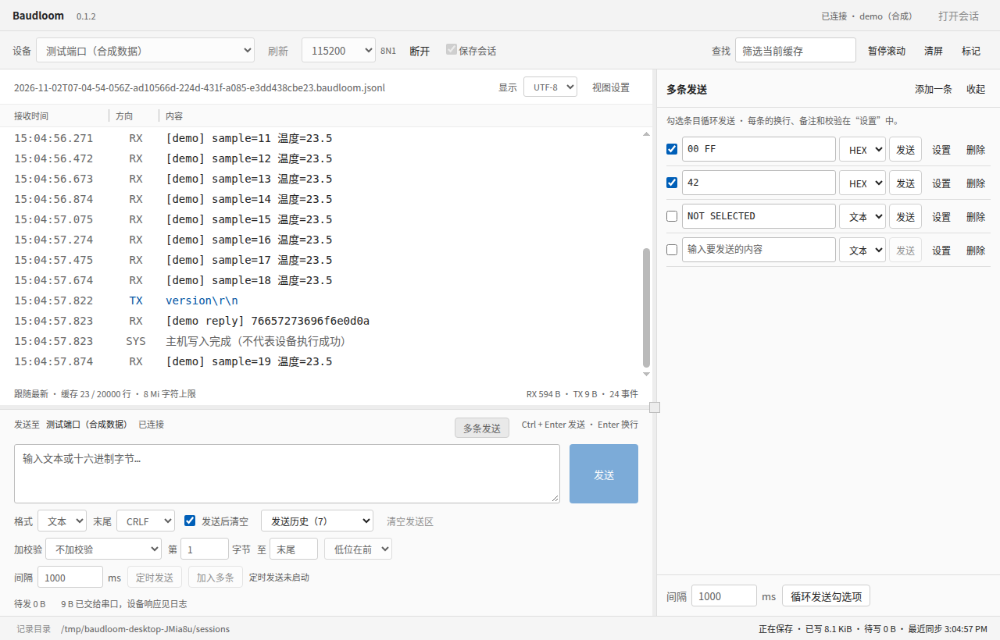

# Baudloom

面向嵌入式开发的桌面串口调试工具。支持文本与 HEX 收发、自动校验、定时发送，以及可选择保存和补写缓存的会话记录。Windows 优先，中文界面，本地运行，无需账号。

[下载 Windows x64 便携版](https://github.com/Oniums/baudloom/releases/latest) · [更新记录](CHANGELOG.md) · [报告问题](https://github.com/Oniums/baudloom/issues)



截图使用合成数据，不包含真实设备日志。

## 功能

- 显示完整串口设备名称；手动连接，未连接时也可编辑发送内容。
- UTF-8 文本与 HEX 相互转换，支持 CR、LF、CRLF 或无换行。
- SUM8、SUM16、XOR8、LRC8、CRC16/MODBUS、CRC16/CCITT-FALSE、CRC32/IEEE 自动校验，可配置字节范围与字节序。
- 单条定时、右侧勾选多条循环发送；断开、错误、刷新或退出会停止定时，不自动续发。
- 日志、发送区和多条面板可调整大小；交汇处同时调整宽高，自动记忆布局。
- 接收时间/方向可隐藏和调整列宽，字号可设为 10–28px。
- 可配置缓存、虚拟列表和缓存内搜索；默认 10000 行 / 4 Mi 字符，最高 50000 行 / 16 Mi 字符。
- 会话默认不保存。连接中启用保存可补写仍保留的原始事件，保留时间与字节，明确提示已淘汰部分。
- 只读重开 `.baudloom.jsonl` 会话，核对记录顺序与校验，提示截断和损坏边界。

## 使用

从 [Releases](https://github.com/Oniums/baudloom/releases) 下载 `Baudloom-0.1.2-win-x64.exe`，放入可写目录后运行。无需携带中间目录包。便携启动器会把运行依赖临时解包到系统 TEMP。

1. 选择串口与波特率，点击“连接”。
2. 在下方输入内容并选择文本/HEX，点击“发送”或按 Ctrl+Enter；Enter 用于换行。
3. 需要留档时勾选“保存会话”，可在连接前或连接中启用；启用后持续保存至断开。
4. 断开后点击“打开会话”读取已有记录。

发送成功只表示主机写入完成，不代表设备执行成功。校验追加在内容之后、文本换行之前；HEX 模式不追加换行。定时任务首次立即发送，后续每条写入完成后等待所设间隔，不承诺硬实时精度。

## 数据存放

默认在 EXE 同级的 `Baudloom-data` 中保存：

| 目录 | 内容 |
|---|---|
| `profile` | 配置、发送历史、多条命令和布局偏好 |
| `sessions` | 勾选保存后创建的会话文件；可通过界面更改记录目录 |
| `cache` | Chromium 缓存 |
| `logs` / `crashes` | 运行诊断数据 |

“不保存会话”不会关闭命令和界面设置的保存。未保存的原始缓存有容量上限，退出或重连后丢弃；清屏和搜索不修改原始缓存或磁盘记录。旧版用户目录中的数据不会自动迁移或删除。

“视图设置”显示内存粗估：默认预算额外约 27–74 MiB，不含程序基础内存，不是实测值或硬上限。事件与显示行并非一一对应，能补写多少以状态栏的原始事件数量为准。

## 当前限制

0.1.2 是早期功能版本，采用 Electron，Windows 单文件包约 106 MiB。

- 单连接；波特率提供 9600、115200、921600，固定 8N1、无 RTS/CTS 流控。
- 单次记录与历史扫描上限为 64 MiB；历史只保留预算内的尾部内容，不支持完整文件分页搜索。
- 尚未实现多端口、自动重连、GB18030、握手线配置、托盘、TXT/LOG 导入和导出。
- Windows 实体设备、驱动兼容、高 DPI、长期负载和完整故障矩阵尚未验收。自动化验证使用合成设备，不替代实体串口测试。
- 当前发布包未签名，没有自动更新功能。

## 开发

要求 Node.js 22.12+：

```sh
npm ci
npm start
npm run format:check
npm run typecheck
npm test
npm run test:desktop
npm run package:win
```

应用正常启动不会生成合成设备。自动化测试才通过 `BAUDLOOM_TEST_MODE=1` 启用测试端口。开发模式的数据写入仓库内的 `Baudloom-data`，已从 Git 与发布包中排除。

- [开发与架构](docs/baudloom-development-guide.md)
- [产品范围与后续计划](docs/baudloom-product-requirements.md)
- [验证计划](docs/baudloom-test-plan.md)
- [贡献指南](CONTRIBUTING.md)
- [应用图标源稿](assets/brand/README.md)

## 开源许可

原创代码、文档及应用图标采用 [MIT License](LICENSE)，Copyright (c) 2026 Baudloom contributors。第三方组件保留各自许可证，见 [THIRD_PARTY_NOTICES.md](THIRD_PARTY_NOTICES.md)。

项目默认样例和测试均使用合成数据。
