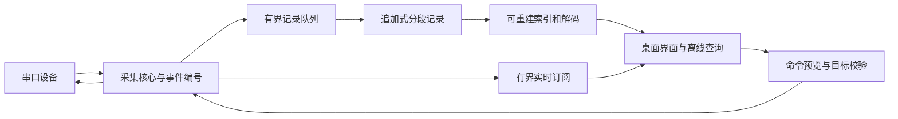

# 串口调试工作台核心架构候选

> 状态：草稿，架构候选，未实现或验证
> 适用范围：Baudloom 首版采集、存储与界面边界
> 更新日期：2026-11-02

## 1. 设计约束

本方案落实[产品需求](baudloom-product-requirements.md)：采集不依赖窗口刷新；原始记录可以独立于解析器读取；故障和恢复边界可以查证。下列格式与数值是原型起点，不是已测性能或稳定文件协议。

## 2. 进程和数据流



桌面界面与采集核心分进程，核心可由托盘入口管理。一个端口只有一个写入控制者；P0 不暴露远程监听服务。未来外部 API 应走与界面相同的校验路径。

记录队列与实时视图队列分开。实时视图跟不上时可以停止实时推送并通过事件游标补读，不允许拖慢记录；记录队列跟不上时必须报告故障，不能假装暂停设备即可保住未知数据。

每个设备独立维护连接和解码状态，避免一台设备的阻塞拖住其他连接。首版不允许运行第三方解析脚本。

## 3. 会话与事件模型

会话包含一个或多个设备、若干采集段和不可变原始事件。重连创建新连接段；核心进程重启创建新采集段。人工备注允许修改，修改历史作为附加事件保留。

| 字段 | 用途 |
|---|---|
| schema_version | 文件与事件格式版本 |
| session_id | 会话标识 |
| capture_id、connection_id | 区分核心生命周期和端口连接生命周期 |
| event_seq | 会话内顺序编号；恢复后从完整记录继续，不冒充设备序号 |
| device_id | 本地设备身份，区别于可变化的 COM 编号 |
| kind | RX、TX 请求/结果、连接、参数、书签、异常、恢复 |
| wall_time_utc、offset_minutes | 人可读时间及当时显示偏移 |
| monotonic_ns | 本采集段的间隔测量依据 |
| payload | 原始字节或带版本的事件字段 |
| provenance | 实测采集、人工记录、导入或解析派生 |

编号表达核心观测顺序，不证明不同设备事件在物理世界的精确先后。操作系统批量交付的字节不具有逐字节硬件时间戳。

文本显示采用增量解码，允许一个字符和一条日志跨多个读取块；断线终止该连接段的残余解码状态，标记片段，不拼接到另一台设备或下一次连接。每行显示时间默认取首字节所在读取块时间；详情可查看结束时间和字节范围。

系统校时不影响同一采集段的单调时间差。跨核心重启、主机休眠等未经验证的时钟边界，不直接相减得出精确间隔；墙钟差应标注为估计。导入日志保留其原始时间精度和缺失情况。

## 4. 存储与恢复候选

建议评估“追加式分段二进制记录 + 可重建索引”，而非把界面中的文本作为唯一记录。

```text
session/
  manifest.json          会话版本、设备信息、用户标签
  segments/
    000001.swlog         带帧边界和校验的事件记录
    000002.swlog
  index.sqlite           可删除重建的查询索引
  exports/               用户主动生成的导出副本
```

每段文件包含格式头、会话身份和段序号，每条记录包含长度、事件头、负载和校验；约束最大记录长度，避免损坏长度导致无界分配。段间保持可检查的顺序关系。格式冻结前必须实现独立读取器和异常截断验证。

初始预算：段大小约 64 MiB；活动尾部每 1 秒或累计 1 MiB 触发同步，另在正常停止时收尾。这只是触发策略，磁盘阻塞时不能保证一秒内持久化。

界面可分别展示已接收字节、待写入字节、最后成功同步的位置与时间。文件写入成功不等于抵抗突然断电；同步完成也需要结合文件系统和硬件语义验证，不宣传硬件级绝对保证。

恢复流程：

1. 只读扫描原段文件，检查身份、顺序、记录长度和校验。
2. 活动尾段不完整时保留原文件，报告最后完整事件，创建新的恢复段继续。
3. 中间损坏时保留已验证区间，明确缺口，不直接截断后宣称其余内容完整。
4. 索引丢失或损坏时从可验证记录重建；manifest 应可由段头恢复必要身份信息，用户标签可能需要单独备份。
5. 记录恢复报告与来源；不能恢复未进入程序或仅存在于丢失内存中的数据。

普通运行不自动删除旧会话。低空间提前提醒；写入失败保留有界待写队列和已保存片段，显示未持久化范围。队列耗尽后不能承诺保全新输入，统计可观测的丢弃并标记未知区间，提供停止采集操作。重试写入使用已验证偏移，避免重复追加半条记录。

元数据和索引可修订，原始记录不因筛选、重解码、备注、脱敏或导出被改写。脱敏只作用于导出副本，保留用户可预览的替换范围；不保证自动规则能发现所有敏感信息。

## 5. 发送与重连

每次发送具有独立 request_id，记录目标、配置、请求内容、主机写入结果和已报告写入字节数。部分写入、超时或进程退出时，结果可以是不确定，不能一律标成“未发送”。

记录模式下，发送请求先进入记录流程，再提交设备写入；记录故障时停止自动发送。用户显式采用仅监视模式时，界面继续标明操作没有完整持久记录。

未来自动化应分别表达 requested、host_write_completed、response_observed 和 condition_matched。响应关联取决于具体协议，普通串口不能仅凭相邻行推断请求与响应一一对应。

定时发送采用单一串行执行队列，不补发软件卡顿期间漏掉的周期；每次发送前检查连接身份。切换端口、意外断开或记录故障后停止，不自动恢复。

设备匹配优先使用可用的 USB 序列号及接口信息，位置作为辅助；无唯一标识或多个匹配时等待人工选择。不能仅凭 VID/PID 或旧 COM 编号把命令发送给另一台同型号设备。

DTR/RTS 配置与流控分开表达。某些板卡将握手线连接到复位电路，操作系统或驱动打开端口时的实际波形需要实机验证；不承诺配置为关闭就必然无瞬态。

## 6. 实现选择与验证顺序

暂不锁定 UI 框架和语言版本。技术选型先验证以下能力：Windows 端口枚举和错误传播、取消阻塞读取、热插拔、后台进程生命周期、文件同步与恢复、虚拟化日志阅读、高 DPI 与中文输入。

可以比较原生 UI 和桌面 Web UI 两条路径。两者都必须复用同一份事件与存储契约；原型以测量结果决定选择，不用框架宣传替代串口和写盘验证。选型时重新核查官方文档、维护状态和依赖授权。

应先固定的接口：设备枚举、开始/停止采集、订阅事件、按游标查询、发送请求、添加标记、导出。实现 API 不意味着首版对外开放服务。

## 7. 设计参考与复用边界

既有 Web Serial 工具中的显示与记录分离、会话标记、容量上限和不完整状态，可作为行为参考。桌面版不直接继承浏览器文件接口的持久化保证，源码复用前另查许可证和依赖。

本地阅读来源：`oniums.github.io/source/tools/assets/serial-save.mjs` 和 `serial-experiment.mjs`，2026-10-30 工作区快照。它们不是本项目运行或恢复能力的验证证据。

外部功能参考：[tio](https://github.com/tio/tio)、[Serial Studio](https://serial-studio.com/)。本项目不复制这些项目或 SSCOM 的源码、图标及专有素材；后续如采用开源组件，单独记录来源与授权。

## 8. 尚待原型验证

- 分段记录与索引方案的磁盘成本、同步延迟和恢复速度。
- 记录队列预算、突发输入策略，以及记录失败后的待写数据保存入口。
- Windows 驱动差异、设备标识稳定性和 DTR/RTS 实际行为。
- UI 框架、核心语言、打包方式和许可证；项目名称已确定为 Baudloom。
- 主机休眠恢复时的连接、时钟域和事件补记策略。

这些问题不影响先制作合成数据交互原型；会影响设备接入、格式冻结和正式发布验收。
